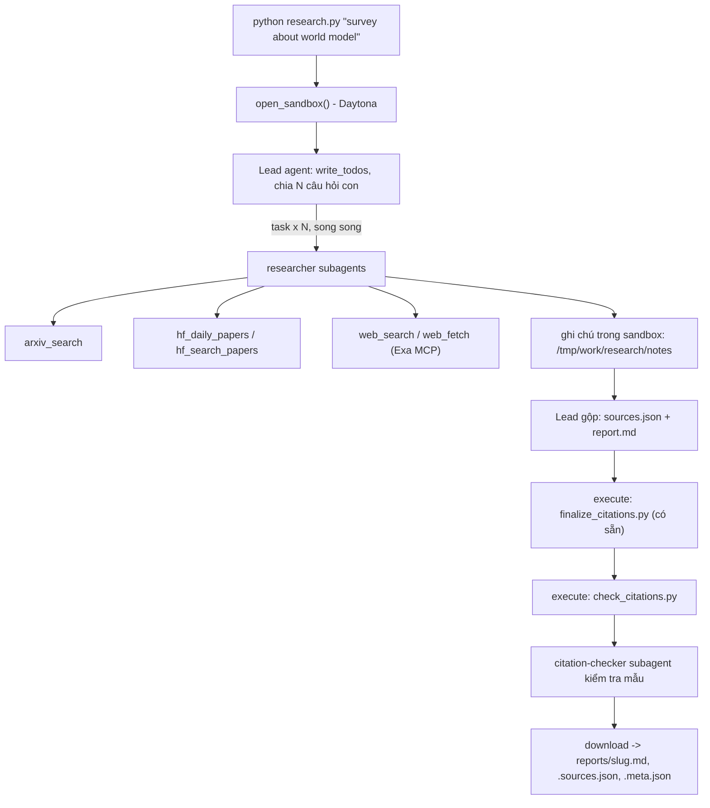

# Deep Research Agent (Deep Agents + Sandbox)

Lab dựng một **hệ thống deep research đa tác tử**: người dùng chỉ cần nhập một chủ đề (ví dụ `survey about world model`), hệ thống tự lập kế hoạch, giao việc cho nhiều subagent, tìm tài liệu trên arXiv, Hugging Face và web, rồi viết một **báo cáo có trích dẫn**.

Hình thức: **bài thực hành cá nhân**. Ngôn ngữ lập trình: Python 3.11 trở lên.

## 1. Mục tiêu học tập

Sau lab, bạn có thể:

1. Dựng agent bằng thư viện Deep Agents (LangChain): công cụ (tool), system prompt, subagent, backend.
2. Dùng **sandbox** (Daytona) làm không gian làm việc và nơi chạy mã cho agent; hiểu vì sao khóa API và công cụ mạng phải nằm ở phía host chứ không nằm trong sandbox.
3. Viết công cụ gọi API ngoài **chịu được giới hạn tốc độ** (retry, backoff, jitter, `Retry-After`).
4. Thiết kế quy trình đa tác tử: lead chia nhỏ câu hỏi, giao cho N researcher chạy song song, tổng hợp và kiểm tra trích dẫn.
5. Tạo báo cáo có thể kiểm chứng: mọi khẳng định có `[n]` trỏ tới một nguồn có thật.

## 2. Hệ thống làm gì



Nguồn dữ liệu:

| Nguồn | Dùng để |
|---|---|
| arXiv API `https://export.arxiv.org/api/query` | Tìm bài theo từ khóa, sắp theo ngày |
| Hugging Face Daily Papers `/api/daily_papers` | Bài đang "trending": upvotes, githubRepo, summary |
| Hugging Face papers search `/api/papers/search?q=` | Tìm bài theo chủ đề |
| Web qua Exa MCP (`web_search_exa`, `web_fetch_exa`) | Blog, survey, trang dự án, nội dung đầy đủ của một URL |

## 3. Cấu trúc thư mục

```
Lab/
├── README.md  GUIDE.md  RUBRIC.md  REPORT_TEMPLATE.md   tài liệu
├── topics.md                 5 chủ đề cần chạy
├── requirements.txt  .env.example  .gitignore
├── model.py                  CÓ SẴN - không sửa: tạo mô hình LLM từ biến môi trường
├── sandbox.py                CÓ SẴN - không sửa: sandbox Daytona (hoặc Docker), upload, download
├── self_check.py             CÓ SẴN - không sửa: tự kiểm tra trước khi nộp (python self_check.py)
├── finalize_citations.py     CÓ SẴN - không sửa: script chạy trong sandbox, tự sinh `## References` và đánh số lại trích dẫn
├── tools.py                  SINH VIÊN CÀI ĐẶT: retry + 5 công cụ nguồn dữ liệu
├── agents.py                 SINH VIÊN CÀI ĐẶT: prompt, subagent, lead agent
├── research.py               SINH VIÊN CÀI ĐẶT: script chính
├── check_citations.py        SINH VIÊN CÀI ĐẶT: kiểm tra trích dẫn, chạy TRONG sandbox
└── reports/                  báo cáo sinh ra (bạn commit vào repo nộp)
```

Mỗi tệp "SINH VIÊN CÀI ĐẶT" là **pseudo-code chạy được** (import được): các hàm có docstring mô tả việc cần làm, các `TODO n` đánh số theo `GUIDE.md`, thân hàm đang `raise NotImplementedError`.

## 4. Cài đặt

```bash
python3 -m venv .venv && source .venv/bin/activate      # Python 3.11+
pip install -r requirements.txt
cp .env.example .env                                     # rồi điền khóa CỦA BẠN
```

Bạn cần ba loại khóa (điền vào `.env`, **không bao giờ commit** `.env`):

| Khóa | Lấy ở đâu | Ghi chú |
|---|---|---|
| LLM (`LAB_MODEL` + khóa nhà cung cấp) | Nhà cung cấp bạn chọn (OpenAI, Anthropic, Google, OpenRouter, Ollama...) | Mô hình **phải hỗ trợ tool calling**. Chép tên mô hình từ tài liệu của nhà cung cấp. |
| `DAYTONA_API_KEY` | https://app.daytona.io | Kiểm tra gói miễn phí / credit hiện hành. Không có tài khoản hoặc hết credit: đặt `SANDBOX=docker` để chạy sandbox trong container Docker cục bộ (xem `.env.example`). |
| `EXA_API_KEY` (khuyến nghị) | https://dashboard.exa.ai/api-keys | Có thể chạy không khóa, nhưng bản miễn phí của MCP bị giới hạn tốc độ rất nhanh. |

## 5. Làm bài

Làm theo thứ tự (chi tiết trong `GUIDE.md`):

1. `check_citations.py`: khởi động nhẹ, thuần Python.
2. `tools.py`: viết `with_retry` và 5 công cụ. Thử riêng từng công cụ: `python tools.py`.
3. `agents.py`: viết prompt, subagent và lead agent.
4. `research.py`: ghép tất cả; chạy một chủ đề:

```bash
python research.py "survey about world model"
```

Kết quả nằm ở `reports/survey-about-world-model.md` cùng `.sources.json` và `.meta.json`.

## 6. Chủ đề và nộp bài

- Đã hoàn thành đủ **5 chủ đề** trong [`topics.md`](topics.md):
  1. `survey about world model`
  2. `survey about reinforcement learning for LLM reasoning`
  3. `survey about LLM agents and tool use`
  4. `survey about video and multimodal generation`
  5. `survey about efficient inference and small language models`
- Chạy tự kiểm tra kiểm định trích dẫn & an toàn bí mật:
  ```bash
  python self_check.py
  ```
  Tất cả 5 chủ đề và kiểm tra git / secrets đều đạt trạng thái `OK` và sẵn sàng nộp (`READY to submit`).
- Cách chấm điểm đối chiếu: xem chi tiết tại [`RUBRIC.md`](RUBRIC.md).

## 7. Cấu trúc và cách đọc thư mục `reports/`

Mỗi lần chạy nghiên cứu thành công trên một chủ đề, hệ thống xuất ra bộ 3 tệp tin tương ứng trong thư mục `reports/`:

1. **Tệp báo cáo Markdown (`reports/<slug>.md`)**:
   - Chứa toàn bộ nội dung khảo sát khoa học theo cấu trúc chuẩn của [`REPORT_TEMPLATE.md`](REPORT_TEMPLATE.md): `# Title`, `## TL;DR`, `## Background`, các mục chuyên đề kỹ thuật (`## <Theme>`), `## Trends and open problems`, và danh mục `## References`.
   - Mọi khẳng định kỹ thuật đều có trích dẫn `[n]`. Danh mục `## References` được tự động sinh bằng script `finalize_citations.py` chạy bên trong sandbox, đảm bảo mỗi nguồn một dòng bắt đầu bằng `[n]` kèm duy nhất 1 URL chuẩn xác.

2. **Tệp danh mục nguồn (`reports/<slug>.sources.json`)**:
   - Mảng JSON chứa danh sách các công trình nghiên cứu được trích dẫn trong bài báo cáo, đánh số liên tục từ 1 đến K không trùng URL:
     ```json
     [
       {
         "n": 1,
         "id": "2404.14294",
         "url": "https://huggingface.co/papers/2404.14294",
         "title": "A Survey on Efficient Inference for Large Language Models",
         "date": "2024-04-22",
         "source": "hf-search"
       }
     ]
     ```
   - Trường `source` phản ánh chính xác công cụ đã thu thập bài viết: `arxiv`, `hf-daily`, `hf-search`, hoặc `web`.

3. **Tệp siêu dữ liệu chấm điểm (`reports/<slug>.meta.json`)**:
   - Bằng chứng kiểm định tự động cho các tiêu chí Rubric:
     * `topic`: Tên chủ đề nghiên cứu gốc.
     * `model`: Tên mô hình LLM điều phối (ví dụ `gpt-4o-mini`).
     * `elapsed_s`: Thời gian thực thi toàn bộ quy trình (giây).
     * `subagent_calls`: Tổng số lượt Lead Agent ủy quyền cho subagents thông qua tool `task` (đảm bảo $\ge 3$ theo Rubric 2.1).
     * `source_families`: Danh sách các họ nguồn tài liệu có mặt trong báo cáo (đảm bảo $\ge 3$ họ độc lập trong `arxiv`, `hf-daily`, `hf-search`, `web` theo Rubric 2.2).
     * `n_sources`: Số lượng bài báo được đưa vào danh mục tham khảo.
     * `tool_calls` & `tokens`: Thống kê số lượng tool calls và token tiêu thụ của Lead Agent.

### Bảng kết quả 5 báo cáo thực nghiệm:

| Chủ đề | Báo cáo | Nguồn | Subagents | Các họ nguồn | Tự kiểm định (`self_check.py`) |
|---|:---:|:---:|:---:|:---|:---:|
| **World Model** | `reports/survey-about-world-model.md` | 5 | 7 | `arxiv`, `hf-daily`, `hf-search` | **OK** |
| **RL for LLM Reasoning** | `reports/survey-about-reinforcement-learning-for-llm-reasoning.md` | 10 | 6 | `arxiv`, `hf-daily`, `hf-search` | **OK** |
| **LLM Agents & Tool Use** | `reports/survey-about-llm-agents-and-tool-use.md` | 8 | 6 | `arxiv`, `hf-daily`, `hf-search` | **OK** |
| **Video & Multimodal Gen** | `reports/survey-about-video-and-multimodal-generation.md` | 10 | 6 | `arxiv`, `hf-daily`, `hf-search` | **OK** |
| **Efficient Inference & SLMs** | `reports/survey-about-efficient-inference-and-small-language-models.md` | 3 | 4 | `arxiv`, `hf-daily`, `hf-search` | **OK** |

## 8. Thời gian, chi phí và an toàn

- Dùng một mô hình **rẻ nhưng hỗ trợ tool calling**, và **đặt giới hạn** (số lần gọi mô hình/công cụ cho lead và subagent, `recursion_limit`): một prompt hỏng có thể khiến agent lặp rất lâu. Đây là hạng mục 2.5 của `RUBRIC.md`.
- Kết quả có tính ngẫu nhiên: cùng một mã có thể cho báo cáo hợp lệ ở lần này và trích dẫn lỗi ở lần sau. Hãy sửa **prompt và mã**, không sửa tay báo cáo.
- Mỗi lần chạy tốn token LLM và thời gian sandbox. `open_sandbox()` luôn dừng và xóa sandbox khi kết thúc, kể cả khi lỗi.
- **Không đưa bí mật vào sandbox.** Sandbox không ngăn được prompt injection hay việc đẩy dữ liệu ra mạng; một trang web độc hại có thể khiến agent chạy lệnh bên trong sandbox. Vì vậy mọi công cụ gọi mạng và mọi khóa ở lại phía host.
- Nội dung lấy từ web là **dữ liệu không đáng tin**: agent không được làm theo chỉ dẫn nằm trong đó.

